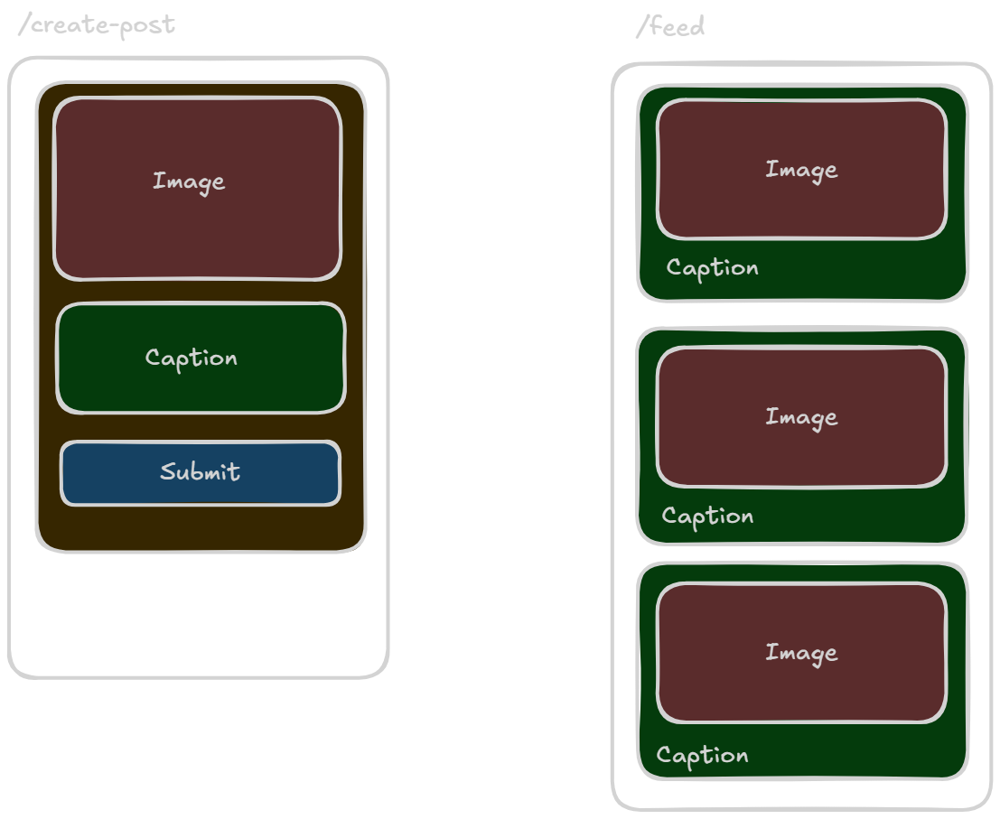

# Post Feed API

A beginner-friendly learning project built to practice React and API integration.

## What I'm Learning
- React components and `useState`
- Fetching data using Axios
- Using `useEffect` to make API requests
- Displaying posts dynamically
- Handling empty states and API errors

## Tech Stack
- React.js
- Axios
- Node.js
- Express.js

## Getting Started

```bash
npm install
npm run dev
```

Start the backend server separately to fetch posts from the API.

## System Architecture

<p align="center">
  
</p>

## Project Status
Learning project — currently under development.