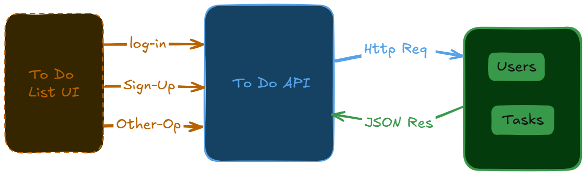

# Todo List RESTful API

A RESTful API built using **Node.js, Express.js, and MongoDB** that allows users to manage their daily tasks securely. The application supports user authentication, CRUD operations, input validation, and pagination.

## Features

- User registration and login
- JWT-based authentication
- Secure password hashing using bcrypt
- Create, read, update, and delete todos
- User-specific todo management
- Input validation and error handling
- Pagination, filtering, and sorting
- MongoDB database integration

## Tech Stack

| Technology | Purpose |
|---|---|
| Node.js | JavaScript runtime |
| Express.js | Backend framework |
| MongoDB | Database |
| Mongoose | Database modeling |
| JWT | Authentication |
| bcrypt | Password hashing |
| Zod | Input validation |
| Postman | API testing |

## Folder Structure

todo-list-api/
│
├── src/
│   ├── config/
│   │   └── db.js
│   │
│   ├── models/
│   │   ├── user.model.js
│   │   └── todo.model.js
│   │
│   ├── controllers/
│   │   ├── auth.controller.js
│   │   └── todo.controller.js
│   │
│   ├── routes/
│   │   ├── auth.routes.js
│   │   └── todo.routes.js
│   │
│   ├── middleware/
│   │   ├── auth.middleware.js
│   │   └── error.middleware.js
│   │
│   ├── validators/
│   │   ├── auth.validator.js
│   │   └── todo.validator.js
│   │
│   └── app.js
│
├── .env
├── .gitignore
├── package.json
├── server.js
└── README.md

## System Architecture



## API Endpoints

### Authentication

| Method | Endpoint | Description |
|---|---|---|
| POST | `/register` | Register a new user |
| POST | `/login` | Authenticate a user |

### Todo Management

| Method | Endpoint | Description |
|---|---|---|
| POST | `/todos` | Create a new todo |
| GET | `/todos` | Retrieve todos |
| GET | `/todos/:id` | Retrieve a specific todo |
| PUT | `/todos/:id` | Update a todo |
| DELETE | `/todos/:id` | Delete a todo |

All todo endpoints require authentication.

## Installation and Setup

**1. Clone the repository**

```bash
git clone https://github.com/YOUR_USERNAME/todo-list-api.git
```

**2. Navigate to the project directory**

```bash
cd todo-list-api
```

**3. Install dependencies**

```bash
npm install
```

**4. Configure environment variables**

Create a `.env` file in the root directory:

```env
PORT=3000
MONGODB_URI=your_mongodb_connection_string
JWT_SECRET=your_jwt_secret
```

**5. Start the development server**

```bash
npm run dev
```

## Authentication

Protected endpoints require a JWT token in the request header.

```http
Authorization: Bearer YOUR_JWT_TOKEN
```

Users can only modify or delete todos that belong to them.

## Example API Request

**Create a Todo**

```http
POST /todos
Content-Type: application/json
Authorization: Bearer YOUR_JWT_TOKEN
```

Request body:

```json
{
  "title": "Buy groceries",
  "description": "Buy milk, eggs, and bread"
}
```

Example response:

```json
{
  "id": "todo_id",
  "title": "Buy groceries",
  "description": "Buy milk, eggs, and bread"
}
```

## HTTP Status Codes

| Status Code | Meaning |
|---|---|
| 200 | Successful request |
| 201 | Resource created |
| 204 | Resource deleted |
| 400 | Bad request |
| 401 | Unauthorized |
| 403 | Forbidden |
| 404 | Resource not found |
| 409 | Conflict |
| 500 | Internal server error |

## Future Improvements

- Refresh token authentication
- Unit and integration testing
- Rate limiting
- Task priorities and due dates
- API documentation using Swagger

## Project Reference

This project is inspired by the [Todo List API project on roadmap.sh](https://roadmap.sh/projects/todo-list-api).

## License

This project is intended for educational and portfolio purposes.